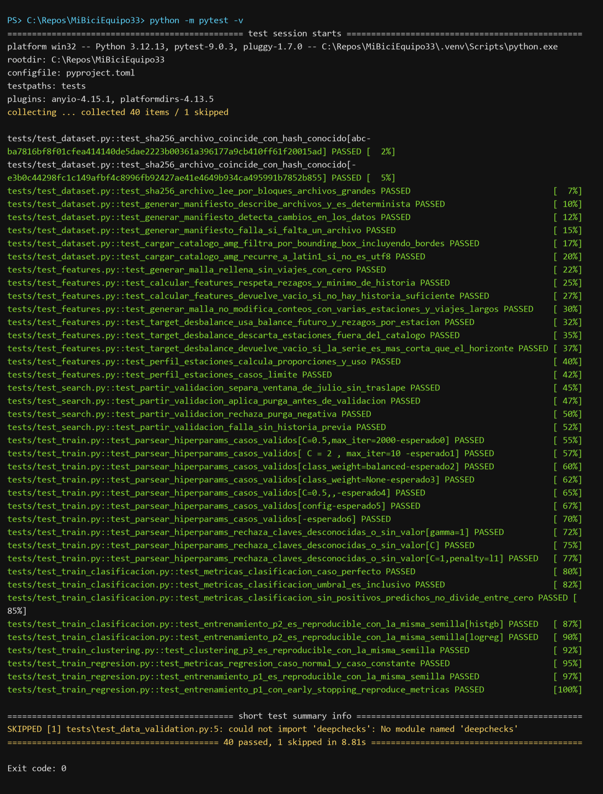
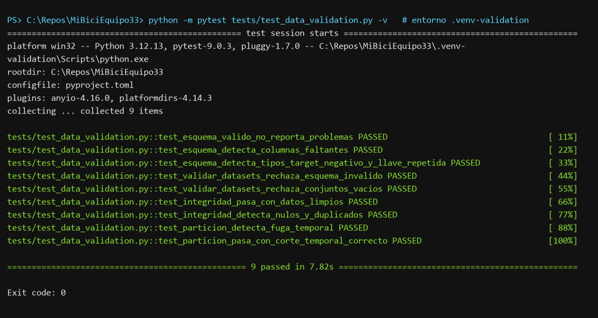
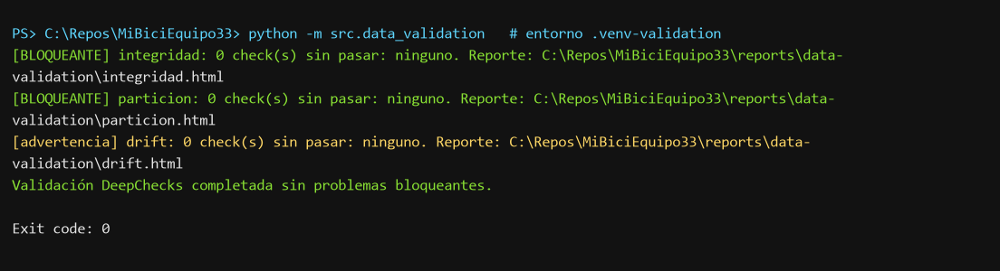
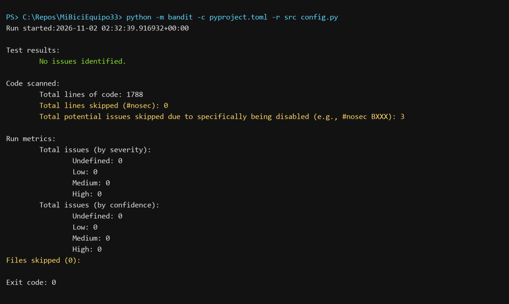
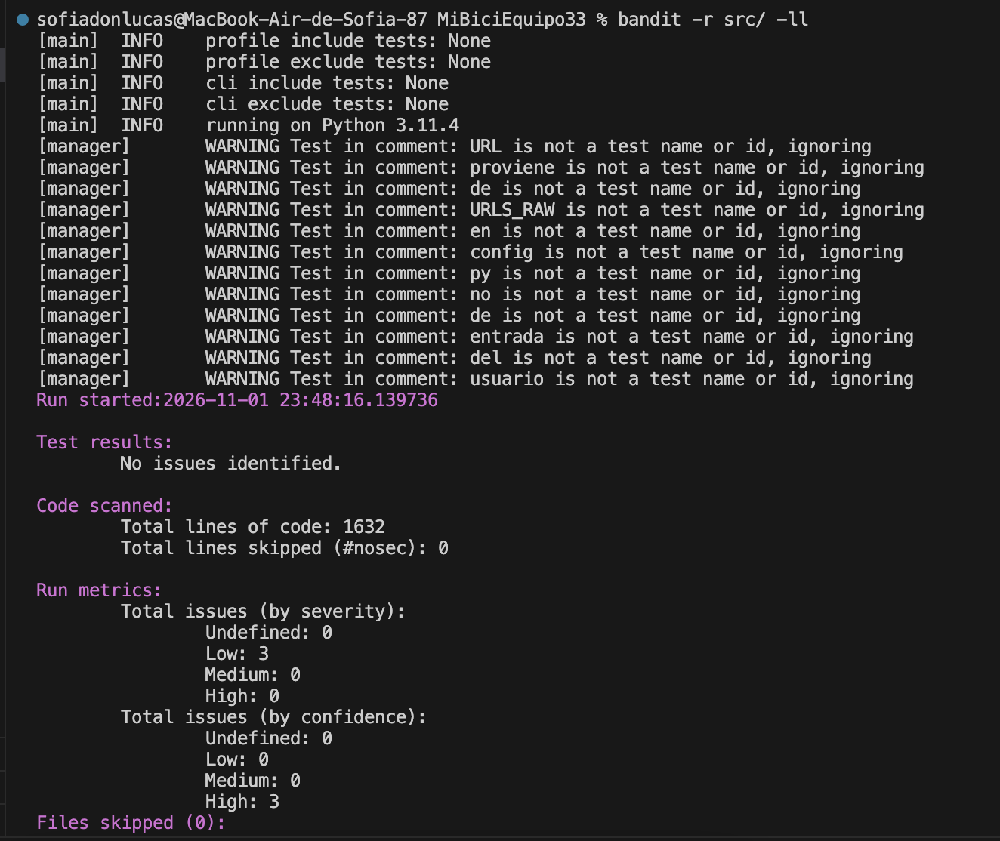
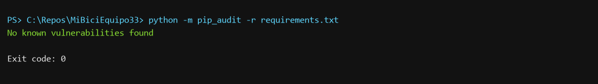
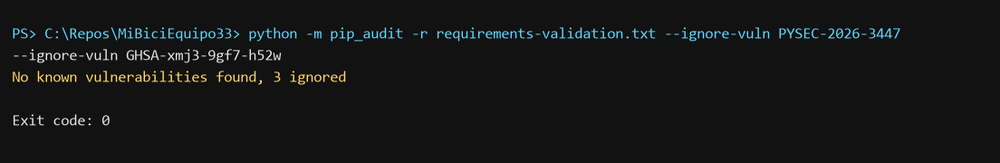
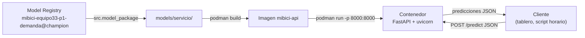

# MiBici Mobility Analytics & MLOps Pipeline (Equipo 33)

Pipeline reproducible de Machine Learning para pronosticar la demanda, detectar el riesgo de desbalance y segmentar las cicloestaciones del sistema de bicicletas públicas MiBici en el Área Metropolitana de Guadalajara (AMG).

## Equipo 33

| Integrante | Rol |
|---|---|
| Leonardo Contreras Palomino | Análisis exploratorio y validación de modelos |
| Sofía Donlucas Bañuelos | Ingesta de datos y reproducibilidad |
| Gerardo Duarte Ceballos | Configuración del repositorio e integración |
| Alejandro Gutiérrez Saldaña | Feature engineering y experimentos MLflow |

## Preguntas del proyecto

| | Tipo | Pregunta | Target |
|---|---|---|---|
| **P1** | Regresión | ¿Cuántos viajes iniciarán en una estación en la próxima hora? | `demanda_salidas` |
| **P2** | Clasificación | ¿Una estación estará en riesgo de quedarse sin bicis o sin anclajes en las próximas horas? | `en_riesgo_desbalance` |
| **P3** | Clustering | ¿Qué grupos de estaciones comparten patrones de uso y dónde se ubican? | `cluster_estacion` |

El planteamiento completo está en el [ML Canvas](references/ml_canvas_v1.2.docx) y en la [definición de datos y pipeline](references/definicion_datos_y_pipeline.docx). El flujo de punta a punta está en el [diagrama del pipeline](references/diagrama_pipeline.md).

## Datos

- **Fuente:** [Datos abiertos de MiBici](https://www.mibici.net/es/datos-abiertos/), viajes mensuales y nomenclatura de estaciones.
- **Rango:** 2026-04-01 a 2026-09-30 (6 meses).
- **Partición temporal:** entrenamiento de abril a agosto y prueba en septiembre. No se usa partición aleatoria, para no filtrar información del futuro.
- **Archivos esperados en `data/raw/`:** `datos_abiertos_2026_04.csv` … `datos_abiertos_2026_09.csv` y `nomenclatura_2026_09.csv`. Se descargan del portal y **no se versionan en Git**.

### Versionado de datos

[references/manifiesto_datos.json](references/manifiesto_datos.json), que sí está en Git, guarda el tamaño y el SHA-256 de cada archivo crudo y un hash global de la versión (`data_version` = `mibici-datos-abiertos-2026_04-2026_09`).

- `python -m src.dataset` compara los CSV locales contra el manifiesto y **se detiene si no coinciden**, indicando qué archivo cambió.
- Cada run de MLflow verifica los datos otra vez y registra `data_version` y `data_sha256`.
- Para registrar una versión nueva a propósito, por ejemplo al agregar un mes, ejecuta `python -m src.dataset --actualizar-manifiesto` y haz commit del manifiesto.

## Estructura del repositorio

Generada con [Cookiecutter Data Science](https://cookiecutter-data-science.drivendata.org/) (`ccds`, `module_name = src`).

```text
├── Makefile               # make requirements | lint | format | clean
├── MLproject              # MLflow Project: entry points ingest, features, train y search
├── Containerfile          # Imagen OCI de la API (FastAPI + modelo exportado)
├── .dockerignore          # Contexto mínimo de la imagen (también lo usa Podman)
├── README.md
├── config.py              # Rutas, fechas, filtros AMG, MLflow y modelos/hiperparámetros por defecto
├── pyproject.toml         # Metadatos del proyecto y configuración de ruff
├── python_env.yaml        # Dependencias de runtime para MLproject (Python 3.12)
├── requirements.txt       # Dependencias con versión fija (Python 3.12)
├── requirements-validation.txt # Dependencias aisladas para DeepChecks
├── requirements-api.txt   # Dependencias mínimas de la imagen de la API
├── data/                  # No versionado
│   ├── raw/               # CSV originales de MiBici
│   ├── interim/           # viajes_amg_limpios.parquet
│   └── processed/         # features_demanda_p1.parquet
├── docs/
├── models/                # Modelos locales (no versionados; los oficiales viven en MLflow); servicio/ = modelo exportado para la imagen
├── notebooks/
│   └── 1.0-lcp-exploratorio.ipynb   # Análisis exploratorio (EDA)
├── references/
│   ├── ml_canvas_v1.2.docx
│   ├── definicion_datos_y_pipeline.docx
│   ├── diagrama_pipeline.md
│   └── manifiesto_datos.json        # Versión de los datos crudos (SHA-256)
├── reports/
│   ├── figures/           # Figuras generadas (también se guardan como artefactos en MLflow)
│   ├── evidence/           # Capturas y logs de pytest, DeepChecks, Bandit y pip-audit
│   └── parte-c-model-registry.md  # Comparación y justificación de modelos promovidos
├── scripts/
│   ├── probar_contenedor.ps1      # Construye la imagen, la ejecuta y prueba la API (Windows)
│   └── probar_contenedor.sh       # Mismo script para Linux/macOS (bash)
├── src/
│   ├── dataset.py         # Verificación de versión, limpieza y filtrado AMG
│   ├── features.py        # Malla horaria, variables cíclicas, rezagos, targets P2 y perfiles P3
│   ├── data_validation.py # Integridad de datos y drift train/test con DeepChecks
│   ├── p1_schema.py       # Target y features compartidos por entrenamiento y validación P1
│   ├── tracking.py        # Utilidades comunes de MLflow (tags, parámetros, verificación de datos)
│   ├── train.py           # Entrena un modelo (pregunta, modelo, hiperparámetros); usado por MLproject
│   ├── search.py          # Búsqueda Optuna con runs anidados y validación temporal
│   ├── register_models.py # Registra los modelos elegidos y promueve el alias champion
│   ├── model_package.py   # Descarga del registry el modelo que se empaqueta en el servicio
│   ├── api.py             # API REST (FastAPI) de predicción P1
│   ├── train_regresion.py       # Baselines P1
│   ├── train_clasificacion.py   # Baselines P2
│   └── train_clustering.py      # Baseline P3
└── tests/                           # Un archivo de pruebas por módulo de src/
    ├── test_dataset.py              # SHA-256, manifiesto y catálogo AMG
    ├── test_features.py             # Malla horaria, rezagos, target P2 y perfiles P3
    ├── test_data_validation.py      # Esquema y suites DeepChecks (entorno de validación)
    ├── test_train.py                # Parseo de hiperparámetros del CLI
    ├── test_search.py               # Partición temporal de validación y purga
    ├── test_model_package.py        # Exportación y carga del modelo del registry
    ├── test_api.py                  # Endpoints, validación de entradas y arranque de la API
    ├── test_train_regresion.py      # Métricas y reproducibilidad P1
    ├── test_train_clasificacion.py  # Métricas y reproducibilidad P2
    └── test_train_clustering.py     # Reproducibilidad P3
```

## Pruebas, validación de datos y seguridad

Resumen de comandos (desde la raíz del repositorio). La evidencia de cada uno está en
[Evidencia de ejecución](#evidencia-de-ejecución).

| Chequeo | Entorno | Comando | Resultado esperado |
|---|---|---|---|
| Pruebas unitarias | `.venv` | `python -m pytest` (o `make test`) | 74 passed, 1 skipped |
| Pruebas de validación de datos | `.venv-validation` | `python -m pytest tests/test_data_validation.py` | 9 passed |
| Validación de datos (DeepChecks) | `.venv-validation` | `python -m src.data_validation` | Código de salida 0, sin checks bloqueantes |
| Análisis estático de seguridad | `.venv` | `python -m bandit -c pyproject.toml -r src config.py` | No issues identified |
| Vulnerabilidades en dependencias | `.venv` | `python -m pip_audit -r requirements.txt` (ver [Chequeos de seguridad](#chequeos-de-seguridad)) | No known vulnerabilities found |

Instala las dependencias desde la raíz con Python 3.12 y el entorno virtual activado:

```powershell
python -m venv .venv
.\.venv\Scripts\Activate.ps1
pip install -r requirements.txt
```

### Pruebas unitarias

Ejecuta todas las pruebas unitarias desde la raíz con un solo comando:

```powershell
python -m pytest -v
# o bien:
make test
```

La configuración de pytest está en [pyproject.toml](pyproject.toml): busca en `tests/`, agrega
la raíz del proyecto al `PYTHONPATH` y muestra el motivo de las pruebas omitidas. Cada archivo
`tests/test_<módulo>.py` prueba el módulo homónimo de `src/`, con casos normales, casos límite
y reproducibilidad del entrenamiento P1, P2 y P3 con la misma semilla. Las pruebas de
`test_data_validation.py` se omiten si DeepChecks no está instalado.

### Validación de datos con DeepChecks

DeepChecks usa un entorno aislado porque su versión actual es incompatible con
scikit-learn 1.9.1 y NumPy 2.5.3, fijados para el entrenamiento. Crea y activa un entorno
Python 3.12 independiente:

```powershell
python -m venv .venv-validation
.\.venv-validation\Scripts\Activate.ps1
pip install -r requirements-validation.txt
python -m pytest tests/test_data_validation.py   # pruebas del módulo de validación
python -m src.data_validation                   # validación del dataset real
```

El comando requiere `data/processed/features_demanda_p1.parquet`, generado con los pasos
de ingesta y features anteriores. Primero se valida el esquema (columnas, tipos, target no
negativo y llave estación-hora única) y luego se ejecutan tres suites de DeepChecks, cada
una con su informe HTML en `reports/data-validation/`:

| Suite | Severidad | Checks |
|---|---|---|
| `integridad` | Bloqueante | Tipos mixtos, % de nulos, tipos de nulos, duplicados y columnas constantes (en train y test) |
| `particion` | Bloqueante | Tamaño de train/test y fuga temporal (fechas de test anteriores al fin de train) |
| `drift` | Advertencia | Drift por variable, del target y multivariado, y estaciones nuevas en test |

Si el esquema o un check bloqueante falla, el comando termina con código 1. Los hallazgos
de drift se reportan pero no detienen el proceso. La validación no cambia los datos ni
los modelos.

### Chequeos de seguridad

**Secretos y configuración.** Ninguna credencial se escribe en el código. La configuración
sensible o dependiente del equipo se lee de variables de entorno (`config.py` carga un
`.env` local con `python-dotenv`; las variables del sistema tienen prioridad). Copia
[.env.example](.env.example) como `.env` y ajusta los valores; `.env`, llaves (`*.pem`,
`*.key`), archivos de credenciales, `mlflow.db`, `mlruns/` y `data/` están en
[.gitignore](.gitignore). Se verificó que ningún archivo versionado ni el historial de Git
contengan `.env`, contraseñas, tokens ni llaves.

**Análisis automático.** Con el entorno de entrenamiento activo:

```powershell
python -m bandit -c pyproject.toml -r src config.py           # análisis estático del código
python -m pip_audit -r requirements.txt                        # CVEs en dependencias
python -m pip_audit -r requirements-validation.txt `
    --ignore-vuln PYSEC-2026-3447 --ignore-vuln GHSA-xmj3-9gf7-h52w
```

(o `make security`). Resultado actual: Bandit y pip-audit sin hallazgos abiertos. Para ver solo
hallazgos de severidad media o alta, agrega `-ll` a bandit.

| Hallazgo | Acción |
|---|---|
| Bandit B310: `urlopen` acepta esquemas como `file://` | La URL proviene solo de `URLS_VIAJES_RAW` en `config.py` (valores fijos del portal MiBici); además se valida que sea `https` antes de abrirla y se suprime con `# nosec B310` |
| Bandit B404/B603/B607: `subprocess` con ruta parcial a `git` | Se resuelve la ruta absoluta con `shutil.which`; argumentos fijos y sin shell |
| mlflow 3.16.1: CVE-2026-53995, CVE-2026-115886, CVE-2026-116691 | Actualizado a 3.17.2 |
| pytest 8.4.2: PYSEC-2026-1845 | Actualizado a 9.0.3 |
| setuptools 80.9.0 (solo entorno DeepChecks): PYSEC-2026-3447, GHSA-xmj3-9gf7-h52w | Riesgo aceptado: setuptools ≥ 81 elimina `pkg_resources`, que DeepChecks 0.19.1 necesita. Ambas fallas afectan la construcción de sdists y la instalación de wheels no confiables; el entorno aislado solo instala paquetes fijados de PyPI y no construye paquetes |

Los modelos se serializan con `skops` (no `pickle`) declarando explícitamente los tipos
confiables, y los hiperparámetros por CLI se leen con `ast.literal_eval`, nunca con `eval`.

## Evidencia de ejecución

Capturas de la ejecución exitosa de cada chequeo (2026-11-01, Windows, Python 3.12.13).
Junto a cada imagen está la salida completa en texto en [reports/evidence/](reports/evidence/).

**Pruebas unitarias** — `python -m pytest -v` en `.venv`: 40 pasan; `test_data_validation.py`
se omite porque DeepChecks vive en su propio entorno ([log](reports/evidence/pytest-tests.txt)).



**Pruebas de validación de datos** — `python -m pytest tests/test_data_validation.py -v` en
`.venv-validation`: 9 pasan ([log](reports/evidence/pytest-data-validation.txt)).



**DeepChecks sobre el dataset real** — `python -m src.data_validation`: integridad, partición
y drift sin checks fallidos, código de salida 0 ([log](reports/evidence/deepchecks-validation.txt)).



**Bandit** — sin hallazgos; los 3 omitidos son los `# nosec` justificados en la tabla de
[Chequeos de seguridad](#chequeos-de-seguridad) ([log](reports/evidence/bandit.txt)).



Escaneo inicial con `bandit -r src/ -ll` (solo severidad media/alta) tras suprimir B310; los 3
hallazgos de severidad baja de `subprocess` se corrigieron después:



**pip-audit** — sin vulnerabilidades conocidas en `requirements.txt`
([log](reports/evidence/pip-audit.txt)) ni en `requirements-validation.txt`, salvo las de
setuptools aceptadas explícitamente ([log](reports/evidence/pip-audit-validation.txt)).




## Reproducción desde un clon limpio

Todas las corridas se lanzan desde el [MLproject](MLproject) con `mlflow run`, no desde notebooks. Se requiere Python 3.12 y [uv](https://docs.astral.sh/uv/). MLflow usa `uv` para crear el entorno declarado en [python_env.yaml](python_env.yaml). Los comandos son para PowerShell.

**1. Clonar e instalar el CLI de MLflow**

```powershell
git clone https://github.com/Howl-coder/TC5061-Proyecto-Equipo33.git
cd TC5061-Proyecto-Equipo33
python -m venv .venv; .\.venv\Scripts\Activate.ps1   # macOS/Linux: source .venv/bin/activate
pip install -r requirements.txt
```

**2. Levantar el servidor de tracking** (terminal aparte, desde la raíz del repo; debe quedar abierta)

El Model Registry requiere un backend con base de datos. `mlflow.db` se crea en la primera ejecución y no se versiona.

```powershell
mlflow server --backend-store-uri sqlite:///mlflow.db --port 5000
```

**3. Ingesta y features**

```powershell
$env:MLFLOW_TRACKING_URI = "http://127.0.0.1:5000"   # bash: export MLFLOW_TRACKING_URI=http://127.0.0.1:5000

mlflow run . -e ingest   --experiment-name mibici-equipo33 --env-manager uv   # descarga CSVs, verifica el manifiesto y limpia -> data/interim/
mlflow run . -e features --experiment-name mibici-equipo33 --env-manager uv   # malla horaria y variables -> data/processed/
```

**4. Modelo elegido de cada pregunta** (hiperparámetros por defecto de `config.py`)

```powershell
mlflow run . -e train -P pregunta=p1 -P modelo=histgb --experiment-name mibici-equipo33 --env-manager uv
mlflow run . -e train -P pregunta=p2 -P modelo=histgb --experiment-name mibici-equipo33 --env-manager uv
mlflow run . -e train -P pregunta=p3 -P modelo=kmeans --experiment-name mibici-equipo33 --env-manager uv
```

**5. Búsqueda de hiperparámetros**

```powershell
mlflow run . -e search -P pregunta=p1 --experiment-name mibici-equipo33 --env-manager uv
mlflow run . -e search -P pregunta=p2 --experiment-name mibici-equipo33 --env-manager uv
mlflow run . -e search -P pregunta=p3 --experiment-name mibici-equipo33 --env-manager uv
```

Las búsquedas supervisadas P1 y P2 ajustan sus combinaciones con datos de abril a junio
y validan en julio. En P2 se excluyen las tres horas anteriores al corte para evitar que
las etiquetas de riesgo del entrenamiento incluyan balances de la validación. Septiembre
permanece reservado para la comparación final y no se usa en Optuna. P3 calcula perfiles
solo hasta agosto, como en el baseline, y compara silhouette dentro de esos perfiles sin
usar datos de septiembre.

Tras escoger los hiperparámetros con las métricas `best_validation_*` del run padre (P3
elige por silhouette usando solo los perfiles de entrenamiento), vuelve a ejecutar cada
configuración como `candidate`: el entry point `train` ajusta con todo el periodo de
entrenamiento y evalúa una sola vez en septiembre. Sustituye los hiperparámetros por los
ganadores observados en MLflow. En P2, usa `tipo_modelo` del run padre para elegir
`-P modelo=logreg` o `-P modelo=histgb`; no lo pases como hiperparámetro:

```powershell
mlflow run . -e train -P pregunta=p1 -P modelo=histgb -P hiperparams="max_iter=300,learning_rate=0.05,max_depth=5,min_samples_leaf=40,l2_regularization=0.1" -P stage=candidate --experiment-name mibici-equipo33 --env-manager uv
mlflow run . -e train -P pregunta=p2 -P modelo=histgb -P hiperparams="max_iter=300,learning_rate=0.05,max_depth=5" -P stage=candidate --experiment-name mibici-equipo33 --env-manager uv
mlflow run . -e train -P pregunta=p3 -P modelo=kmeans -P hiperparams="k_min=3,k_max=10,n_init=10" -P stage=candidate --experiment-name mibici-equipo33 --env-manager uv
```

En P2 el entrenamiento final también deja un margen de tres horas antes del test, pues
el target observa el balance de las siguientes tres horas. Los baselines de P2 deben
volverse a correr con esta purga antes de comparar sus métricas con las de los candidatos.

| Pregunta | Modelo elegido | Run | Hiperparámetros (`config.HIPERPARAMS_POR_DEFECTO`) |
|---|---|---|---|
| P1 | `HistGradientBoostingRegressor` | `P1-baseline-histgb` | `max_iter=200`, `learning_rate=0.1`, `max_depth=None`, `min_samples_leaf=20`, `l2_regularization=0.0` |
| P2 | `HistGradientBoostingClassifier` | `P2-baseline-histgb` | `max_iter=200`, `learning_rate=0.1`, `max_depth=None`, `class_weight=balanced` |
| P3 | `StandardScaler` + `KMeans` | `P3-baseline-kmeans` | `k_min=3`, `k_max=10`, `n_init=10` (k elegido por silhouette) |

Los baselines de comparación se lanzan igual, por ejemplo:

```powershell
mlflow run . -e train -P pregunta=p1 -P modelo=naive -P hiperparams="columna_naive=lag_salidas_1h" --experiment-name mibici-equipo33 --env-manager uv
mlflow run . -e train -P pregunta=p1 -P modelo=naive --experiment-name mibici-equipo33 --env-manager uv
mlflow run . -e train -P pregunta=p2 -P modelo=logreg --experiment-name mibici-equipo33 --env-manager uv
```

La interfaz de MLflow queda disponible en http://127.0.0.1:5000.

### Entry points del MLproject

| Entry point | Parámetros | Ejecuta |
|---|---|---|
| `ingest` | — | `python -m src.dataset` |
| `features` | — | `python -m src.features` |
| `train` | `pregunta` (`p1`, `p2`, `p3`; obligatorio), `modelo`, `hiperparams`, `stage` (`baseline` o `candidate`) | `python -m src.train` (un run por ejecución) |
| `search` | `pregunta` (`p1`, `p2`, `p3`; obligatorio), `n_trials` (default: 5) | `python -m src.search` (run padre y runs hijos anidados) |

- `modelo` e `hiperparams` valen `config` por defecto: se toman `MODELOS_POR_DEFECTO` y `HIPERPARAMS_POR_DEFECTO` de [config.py](config.py). Rutas, fechas, partición y semilla también salen de ahí.
- Modelos disponibles: P1 `naive`, `histgb`; P2 `logreg`, `histgb`; P3 `kmeans`.
- `hiperparams` usa el formato `clave=valor,clave=valor`, sin espacios, y solo reemplaza las claves indicadas, por ejemplo `-P hiperparams="max_iter=300,learning_rate=0.05"`. Las claves válidas son las de `HIPERPARAMS_POR_DEFECTO` para ese modelo.
- `--experiment-name mibici-equipo33` es obligatorio: el script fija ese experimento y MLflow rechaza el run si no coincide. Si el experimento no existe, MLflow lo crea.
- Con `--env-manager local` se reutiliza el entorno ya activado en lugar de crear uno con `uv`.
- Para otro servidor de tracking, cambia `MLFLOW_TRACKING_URI`; `config.py` usa `http://127.0.0.1:5000` si la variable no está definida.

> Para que los runs queden ligados a un commit exacto, lánzalos con el árbol de trabajo limpio (`git status` sin cambios). Si hay cambios sin commit, el run se etiqueta con `git_dirty=True`.

## Experimento en MLflow

- **Experimento:** `mibici-equipo33`, registrado en el servidor local `http://127.0.0.1:5000`, respaldado por `mlflow.db` (SQLite, no versionado).
- **Tags de cada run:** `equipo`, `question` (`P1`/`P2`/`P3`), `git_commit`, `git_dirty`, `model_family`, `stage_of_work` (`baseline`, `search`, `candidate`).
- **Parámetros de cada run:** `fecha_inicio`, `fecha_fin`, `fecha_fin_train`, `fecha_inicio_test`, `data_version`, `data_sha256`, archivos usados, `random_state` e hiperparámetros del modelo.
- **Artefactos:** figura de evaluación de cada run y el modelo serializado. P3 agrega además el mapa de clusters, los perfiles horarios, la curva de selección de k y la tabla de asignación de estaciones.

| Run | Pregunta | Modelo |
|---|---|---|
| `P1-baseline-naive-1h` | P1 | Persistencia: misma demanda que la hora anterior |
| `P1-baseline-naive-168h` | P1 | Naive estacional: misma hora de la semana anterior |
| `P1-baseline-histgb` | P1 | `HistGradientBoostingRegressor` |
| `P2-baseline-logreg` | P2 | `LogisticRegression` (`class_weight=balanced`) |
| `P2-baseline-histgb` | P2 | `HistGradientBoostingClassifier` (`class_weight=balanced`) |
| `P3-baseline-kmeans` | P3 | `StandardScaler` + `KMeans`, k ∈ [3, 10] elegido por silhouette |

Los runs registrados antes del MLproject conservan sus nombres anteriores (`P1-baseline-naive-lag1h`, `P2-baseline-logistic-regression`, etc.).

### Resultados baseline (test: septiembre 2026)

| Pregunta | Mejor baseline | Métricas |
|---|---|---|
| P1 | HistGradientBoosting | RMSE 1.48 · MAE 0.84 · R² 0.69 (naive 168 h: RMSE 2.00 · R² 0.44) |
| P2 | HistGradientBoosting | ROC-AUC 0.86 · PR-AUC 0.34 · Recall 0.88 · F1 0.32 (positivos ≈ 6.6 %; referencia previa a la purga temporal) |
| P3 | K-Means, k = 3 | Silhouette 0.09 · Davies-Bouldin 2.61 |

Los resultados P2 de esa tabla son una referencia histórica: la implementación actual
purga las tres horas previas al test para impedir fuga en el target de horizonte de tres
horas. Ejecuta de nuevo el baseline y los candidatos para compararlos bajo el mismo corte.

### Decisiones de diseño

- **Target de P2:** los datos abiertos no incluyen la ocupación real de las estaciones. Por eso se aproxima como `|balance neto acumulado en t+1..t+3| ≥ 30 % de dpcapacity`. Los dos valores son constantes en `src/train_clasificacion.py`.
- **P3:** el perfil de cada estación se calcula solo con el periodo de entrenamiento. La latitud y la longitud se usan para el mapa, no para agrupar.
- **Calidad de datos:** se eliminan los `Viaje_Id` duplicados, los viajes de menos de 1 minuto o más de 24 horas y las estaciones fuera del AMG o sin registro en la nomenclatura.
- **Privacidad:** `Usuario_Id`, `Genero` y `Anio_de_nacimiento` no se usan como variables de los modelos.

## Parte C — Model Registry y reporte

Los modelos seleccionados se registran en el Model Registry con nombres estables y se
promueven con el alias `champion`. Se usan aliases en vez de las etapas legacy (`Staging`,
`Production`), porque son el esquema vigente de MLflow y permiten cambiar la versión de
producción sin recrear el modelo registrado.

| Pregunta | Nombre en Model Registry | URI de producción |
|---|---|---|
| P1 — demanda | `mibici-equipo33-p1-demanda` | `models:/mibici-equipo33-p1-demanda@champion` |
| P2 — riesgo | `mibici-equipo33-p2-riesgo` | `models:/mibici-equipo33-p2-riesgo@champion` |
| P3 — grupos | `mibici-equipo33-p3-grupos` | `models:/mibici-equipo33-p3-grupos@champion` |

Después de comparar los runs baseline y candidatos de cada pregunta en la UI de MLflow,
registra los tres IDs elegidos. El backend debe estar activo, `MLFLOW_TRACKING_URI` debe
apuntar a él y los runs seleccionados deben provenir de un árbol Git limpio:

```powershell
python -m src.register_models `
  --p1-run-id <RUN_ID_P1> --p1-justification "Justificación basada en RMSE, MAE, R2 y costo." `
  --p2-run-id <RUN_ID_P2> --p2-justification "Justificación basada en recall, PR-AUC, F1 y costo." `
  --p3-run-id <RUN_ID_P3> --p3-justification "Justificación basada en silhouette, Davies-Bouldin y costo."
```

El comando valida experimento, pregunta, etapa, métricas, commit, limpieza del árbol,
versión de datos, firma y carga del modelo. Registra cada versión desde su run de origen,
agrega tags con el experimento, `run_id`, commit y `data_version`, asigna el alias
`champion` y verifica la carga por URI de producción. Una promoción nueva mueve el alias
al run que se indique. El reporte [reports/parte-c-model-registry.md](reports/parte-c-model-registry.md)
documenta los criterios y, después de una promoción exitosa, contiene las métricas reales,
duraciones y justificaciones de los runs seleccionados.

La selección debe privilegiar `test_rmse` bajo para P1, `test_recall` y `test_pr_auc` para
P2 por el costo de no detectar estaciones en riesgo, y `silhouette` junto con
`davies_bouldin` para P3. La duración del entrenamiento se reporta como referencia de
costo; el costo de inferencia no está medido.

Para cargar un modelo promovido:

```powershell
python -c "import mlflow.pyfunc; mlflow.pyfunc.load_model('models:/mibici-equipo33-p1-demanda@champion')"
```

## Parte D — Modelo como servicio

El modelo P1 (demanda de salidas por estación en la próxima hora) se sirve como API REST
en un contenedor OCI. Motor de contenedores elegido: **Podman** (los comandos de Docker son
equivalentes; ver la [guía de uso](#6-guía-de-uso-construir-levantar-y-consumir-el-servicio)).



### Estrategia de despliegue: inferencia en línea (tiempo real) con micro-lotes

Se eligió un servicio síncrono que responde en el momento de la petición, en lugar de un
proceso por lotes que precalcule predicciones:

- **El horizonte es de una hora.** La predicción depende de rezagos de las últimas horas
  (`lag_salidas_1h`, `rolling_mean_6h`, …) que solo existen cuando termina la hora anterior.
  Un lote nocturno no puede calcularlos para las horas siguientes y sus resultados quedarían
  obsoletos en una hora.
- **El uso es operativo.** El rebalanceo de bicicletas necesita consultar una estación o
  todo el sistema justo antes de decidir, desde un tablero o un script.
- **Cubre también el caso por lotes.** `/predict` acepta hasta 1000 instancias por
  petición, así que las ~480 estaciones del catálogo caben en una sola llamada (por ejemplo,
  un script al inicio de cada hora) sin otro componente.
- **Es barato de servir.** El modelo (HistGradientBoosting, `model.skops` de 1.4 MB) corre en CPU; medido
  desde el host contra el contenedor, la mediana fue de unos 50 ms con 1 instancia y unos
  20 ms con 480. El servicio no guarda estado, así que se puede escalar con más réplicas
  detrás de un balanceador.
- **Es reproducible.** El modelo va dentro de la imagen (ver la sección 1), de modo que cada
  imagen corresponde a una versión fija del registry.

Limitación: el cliente debe calcular las variables (calendario y rezagos) igual que
[src/features.py](src/features.py). Un siguiente paso sería un endpoint que reciba solo la
estación y la hora y obtenga los rezagos de un almacén de features.

### 1. Recuperación del modelo desde el Model Registry

**Modelo servido:** P1 — regresión de demanda, `models:/mibici-equipo33-p1-demanda@champion`
(también se puede fijar una versión concreta).

**Opción elegida: empaquetar en la imagen el modelo descargado del registry.** El modelo se
resuelve en el Model Registry por nombre y alias (o versión), se descarga a
`models/servicio/` y esa carpeta se copia a la imagen. El contenedor no necesita
`MLFLOW_TRACKING_URI` ni acceso al servidor de MLflow. Se eligió así porque:

- El experimento `mibici-equipo33` guarda sus artefactos en una ruta local del equipo que
  entrenó (`file:C:/Repos/MiBiciEquipo33/mlruns/1`). El servidor de tracking devuelve esa
  ruta, no los archivos, así que un contenedor que consultara el registry por
  `host.containers.internal:5000` encontraría la versión pero no podría descargar el modelo.
- La imagen queda autocontenida: se comporta igual en cualquier máquina, no depende de que el
  servidor esté encendido y la versión servida queda fija al construirla. Para cambiar de
  versión se vuelve a exportar y a construir la imagen.

Con el servidor de MLflow activo (paso 2 de la reproducción) y el modelo ya promovido con
`src.register_models` (Parte C):

```powershell
$env:MLFLOW_TRACKING_URI = "http://127.0.0.1:5000"
python -m src.model_package --pregunta p1               # models:/mibici-equipo33-p1-demanda@champion
python -m src.model_package --pregunta p1 --version 3   # o una versión registrada concreta
```

[src/model_package.py](src/model_package.py) resuelve el alias al número de versión antes de
descargar, comprueba que el modelo tenga firma y lo carga para hacer una predicción de
verificación con su `input_example`. En `models/servicio/` quedan los archivos del modelo
MLflow (`MLmodel`, `model.skops`, `requirements.txt`, `python_env.yaml`, ejemplo de entrada)
y `registro.json`, con el nombre, la versión, el alias pedido, el `run_id` y los tags de
linaje (`git_commit`, `data_version`, etc.). Si la carpeta destino existe y no es una
exportación previa, el comando se detiene sin borrarla.

Dentro del contenedor el modelo se carga con `cargar_modelo_empaquetado()`, que lee la
carpeta indicada en `MODELO_SERVICIO_DIR` (por defecto `models/servicio`).

> Alternativa no elegida: consultar el registry en tiempo de ejecución con
> `MLFLOW_TRACKING_URI=http://host.containers.internal:5000`. Requeriría recrear el
> experimento con artefactos servidos por el servidor (`mlflow-artifacts:/`) y lanzar
> `mlflow server` con `--host 0.0.0.0 --allowed-hosts "localhost,127.0.0.1,host.containers.internal"`.

### 2. API REST con FastAPI

[src/api.py](src/api.py) expone el modelo P1. Al arrancar carga `models/servicio/` (o
`MODELO_SERVICIO_DIR`) y comprueba que la firma del modelo tenga exactamente las variables de
[src/p1_schema.py](src/p1_schema.py); si falta el modelo o es de otra pregunta, el servicio no
inicia.

```powershell
uvicorn src.api:app --host 127.0.0.1 --port 8000
```

| Método | Ruta | Respuesta |
|---|---|---|
| `GET` | `/health` | `{"status": "ok"}` cuando el modelo está cargado |
| `GET` | `/modelo` | Nombre, versión, alias y `run_id` del registry, target y features |
| `POST` | `/predict` | Salidas esperadas en la próxima hora para cada instancia |
| `GET` | `/docs` | Documentación interactiva (OpenAPI) con un ejemplo listo para probar |

`/predict` recibe de 1 a 1000 instancias con las 11 variables del modelo, tal como las calcula
[src/features.py](src/features.py): calendario cíclico (`hora_*` con periodo 24, `dia_*` con
periodo 7 y lunes = 0), `es_fin_de_semana` y rezagos de salidas de la estación. Las
predicciones negativas se recortan a 0, igual que en la evaluación. Hay un ejemplo de
petición y respuesta en la [guía de uso](#6-guía-de-uso-construir-levantar-y-consumir-el-servicio).

### 3. Validación de entradas y salidas

Los esquemas están definidos con Pydantic en [src/api.py](src/api.py) y se publican en
`/docs` y `/openapi.json`.

| Esquema | Uso | Reglas |
|---|---|---|
| `SolicitudPrediccion` | Cuerpo de `POST /predict` | `instancias`: lista de 1 a 1000 `EntradaDemanda`; sin campos extra |
| `EntradaDemanda` | Una estación-hora | Las 11 variables son obligatorias; no se aceptan campos desconocidos (p. ej. `Origen_Id`) ni `NaN`/`Infinity` |
| | Calendario | `hora_*`, `dia_*` en [-1, 1]; cada par debe cumplir $\sin^2 + \cos^2 = 1$ y codificar una hora (0-23) o día (0-6) entero; `es_fin_de_semana` ∈ {0, 1} y debe coincidir con el día codificado (sábado o domingo) |
| | Rezagos | `lag_salidas_*` y `rolling_mean_6h` ≥ 0 |
| `RespuestaPrediccion` | Respuesta de `POST /predict` | `modelo`, `version`, `target` y `predicciones` (≥ 0, en el orden de las instancias) |
| `RespuestaModelo`, `RespuestaSalud` | `GET /modelo`, `GET /health` | Metadatos del modelo servido; `status = "ok"` |

Las coherencias de calendario toleran senos y cosenos redondeados a 3 decimales. Una entrada
inválida devuelve HTTP 422 con el campo y el motivo, sin repetir los valores recibidos:

```json
{"detail": [{"type": "value_error", "loc": ["body", "instancias", 0],
             "msg": "Value error, es_fin_de_semana no coincide con el día de dia_sin/dia_cos."}]}
```

### 4. Contenedor

[Containerfile](Containerfile) (formato OCI; Docker lo acepta con `-f Containerfile`) construye
la imagen en dos etapas sobre `python:3.12.13-slim`, la misma versión de Python con la que se
entrenó:

1. **dependencias**: crea `/opt/venv` e instala [requirements-api.txt](requirements-api.txt), un
   subconjunto de `requirements.txt` con las mismas versiones de scikit-learn, skops, NumPy y
   pandas que el entrenamiento, más `mlflow-skinny` (suficiente para `mlflow.pyfunc`), FastAPI y
   uvicorn. No incluye Optuna, Matplotlib, Jupyter ni el servidor de MLflow.
2. **final**: copia el entorno, `config.py`, los cuatro módulos que usa la API y el modelo de
   `models/servicio/`; corre como usuario sin privilegios (`mibici`, UID 10001) y expone el
   puerto 8000 con uvicorn.

[.dockerignore](.dockerignore) (Podman también lo lee) deja en el contexto de construcción solo
esos archivos, así que `data/`, `mlflow.db`, `mlruns/` y `.env` nunca llegan a la imagen.
Los comandos para construirla y ejecutarla están en la
[guía de uso](#6-guía-de-uso-construir-levantar-y-consumir-el-servicio).

La imagen no necesita `MLFLOW_TRACKING_URI` ni acceso a la red. Para servir otra versión,
vuelve a exportar y reconstruye la imagen. Al arrancar, MLflow puede avisar que `psutil` o
`rich` (dependencias del entorno de entrenamiento registradas con el modelo) no están
instalados; no se usan para predecir.

### 5. Construcción y prueba del contenedor

Requisito en Windows: Podman con su máquina virtual (WSL2). La instalación pide permisos de
administrador:

```powershell
winget install -e --id RedHat.Podman     # terminal con permisos de administrador
podman machine init
podman machine start
```

Los scripts de prueba construyen la imagen, la ejecutan en segundo plano, esperan a `/health`
y comprueban que:

- `GET /modelo` informe el modelo y la versión del registry empaquetados;
- `POST /predict` con dos instancias (lunes 8:00 y domingo 0:00) devuelva HTTP 200 y dos
  predicciones ≥ 0;
- una entrada incoherente (`es_fin_de_semana = 1` en lunes) devuelva HTTP 422.

Al terminar detienen y eliminan el contenedor, aunque una comprobación falle.

**Windows (PowerShell):**
```powershell
python -m src.model_package --pregunta p1   # si models/servicio no existe
.\scripts\probar_contenedor.ps1             # Podman; con Docker: -Motor docker
```

**Linux / macOS (bash):**
```bash
python -m src.model_package --pregunta p1   # si models/servicio no existe
bash scripts/probar_contenedor.sh           # Podman; con Docker: bash scripts/probar_contenedor.sh docker
```

Modelo empaquetado: `mibici-equipo33-p1-demanda` versión 1 (`@champion`), run
`606849422b6941c38df8c9039bdcff5d`, commit `c59e6e0`.

**Resultado** (2026-11-08, Windows, Podman 5.8.3 con máquina WSL2): la imagen
`localhost/mibici-api:latest` (ID `61cf7dd43e72`, 588 MB) se construyó y el contenedor
respondió correctamente; corre como `uid=10001(mibici)` y se elimina al terminar la prueba
([log completo](reports/evidence/podman-contenedor.txt)):

```text
Successfully tagged localhost/mibici-api:latest
GET /health -> ok
GET /modelo -> mibici-equipo33-p1-demanda v1 (run 606849422b6941c38df8c9039bdcff5d)
POST /predict -> {"modelo":"mibici-equipo33-p1-demanda","version":"1","target":"demanda_salidas","predicciones":[4.355850750022855,0.2495090943117954]}
POST /predict (entrada incoherente) -> 422 {"detail":[{"type":"value_error","loc":["body","instancias",0],"msg":"Value error, es_fin_de_semana no coincide con el día de dia_sin/dia_cos."}]}
Prueba del contenedor superada.
```

Para revisar la imagen: `podman images localhost/mibici-api`, `podman history
localhost/mibici-api:latest` o `podman image inspect localhost/mibici-api:latest`.

### 6. Guía de uso: construir, levantar y consumir el servicio

Requisitos: el modelo exportado en `models/servicio/` (sección 1) y Podman con su máquina
iniciada (sección 5). Todos los comandos se ejecutan desde la raíz del repositorio.

| Paso | Podman (elegido) | Docker |
|---|---|---|
| 1. Construir la imagen | `podman build -t mibici-api:latest .` | `docker build -f Containerfile -t mibici-api:latest .` |
| 2. Levantar el contenedor | `podman run -d --rm --name mibici-api -p 8000:8000 mibici-api:latest` | `docker run -d --rm --name mibici-api -p 8000:8000 mibici-api:latest` |
| 3. Comprobar que está listo | `podman ps` y `podman logs mibici-api` | `docker ps` y `docker logs mibici-api` |
| 4. Detener (y eliminar) | `podman stop mibici-api` | `docker stop mibici-api` |

Podman construye con el `Containerfile` sin indicarlo; Docker necesita `-f Containerfile`.
Con `-p 8000:8000` la API queda en http://127.0.0.1:8000 y la documentación interactiva en
http://127.0.0.1:8000/docs. Para usar otro puerto del host: `-p 8080:8000`.

**Consumir la API.** Una vez arriba, `GET /health` devuelve `{"status":"ok"}` y `GET /modelo`
indica qué versión del registry se sirve. Petición de predicción para una estación un lunes
a las 8:00 ($\sin(2\pi \cdot 8/24) \approx 0.866$, $\cos(2\pi \cdot 8/24) = -0.5$) que tuvo 3, 2 y
4 salidas en las tres horas anteriores:

PowerShell:

```powershell
$cuerpo = @{ instancias = @(@{
    hora_sin = 0.866; hora_cos = -0.5; dia_sin = 0.0; dia_cos = 1.0; es_fin_de_semana = 0
    lag_salidas_1h = 3; lag_salidas_2h = 2; lag_salidas_3h = 4
    lag_salidas_24h = 5; lag_salidas_168h = 4; rolling_mean_6h = 3.2
}) } | ConvertTo-Json -Depth 3
Invoke-RestMethod -Method Post -Uri http://127.0.0.1:8000/predict -ContentType application/json -Body $cuerpo
```

bash (Linux, macOS o Git Bash):

```bash
curl -s -X POST http://127.0.0.1:8000/predict \
  -H "Content-Type: application/json" \
  -d '{"instancias": [{"hora_sin": 0.866, "hora_cos": -0.5, "dia_sin": 0.0, "dia_cos": 1.0,
       "es_fin_de_semana": 0, "lag_salidas_1h": 3, "lag_salidas_2h": 2, "lag_salidas_3h": 4,
       "lag_salidas_24h": 5, "lag_salidas_168h": 4, "rolling_mean_6h": 3.2}]}'
```

Respuesta del contenedor con la versión 1 empaquetada (HTTP 200):

```json
{"modelo": "mibici-equipo33-p1-demanda", "version": "1", "target": "demanda_salidas", "predicciones": [4.355850750022855]}
```

Es decir, se esperan unas 4.4 salidas en esa estación durante la siguiente hora. Para varias
estaciones u horas se envían varias instancias en la misma lista (máximo 1000) y
`predicciones` conserva su orden. Si una entrada es inválida la API responde HTTP 422 con el
campo y el motivo (ver la sección 3).

Para construir, levantar y probar todo de una vez:
- Windows: `.\scripts\probar_contenedor.ps1` (`-Motor docker` para Docker)
- Linux/macOS: `bash scripts/probar_contenedor.sh` (`docker` como segundo argumento para Docker)
