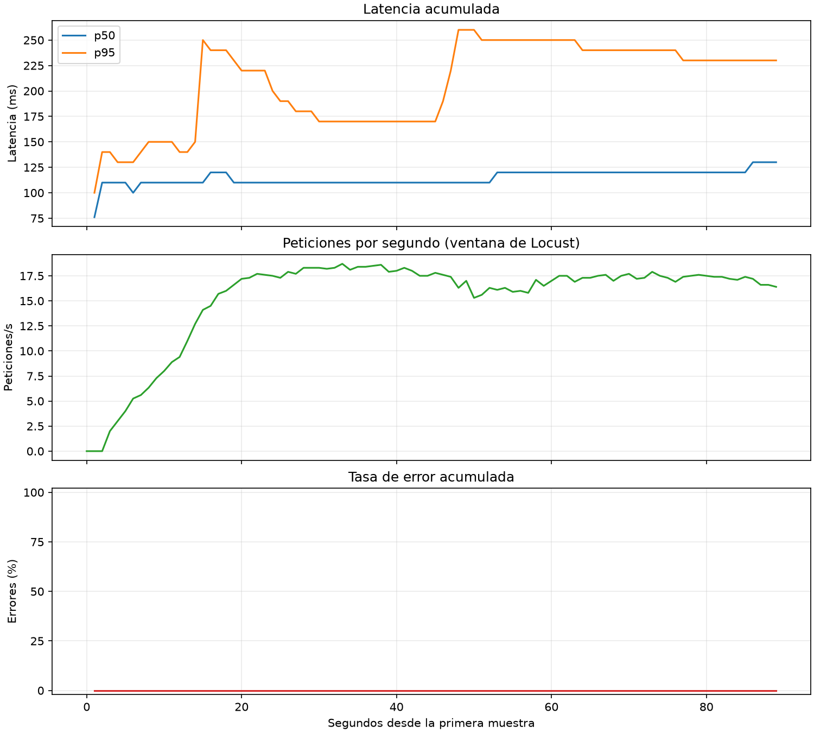

# Prueba de carga de la API P1

## Escenario

- Fecha: 20 de noviembre de 2026, 17:40–17:41 (UTC-6).
- Servicio: una instancia de la imagen del `Containerfile`, ejecutada con Podman;
  modelo `mibici-equipo33-p1-demanda` versión 1, run `606849422b6941c38df8c9039bdcff5d`.
- Equipo: Windows 11, Intel Core i7-11850H (8 núcleos, 16 hilos); máquina Podman
  WSL con 8 CPU y 2 GiB de memoria. El cliente Locust y el servidor compartieron equipo.
- Locust 2.47.0 y Python 3.12.13; 20 usuarios, incorporación de 2 usuarios/s,
  duración de 90 s incluyendo la rampa, sin reiniciar estadísticas al terminarla.
- Cada usuario espera aleatoriamente entre 0.5 y 1.5 s entre peticiones y envía
  una instancia por `POST /predict`, con horas, días y rezagos sintéticos válidos.
  Se cuentan como errores las respuestas HTTP fallidas, errores de conexión,
  JSON inválido y respuestas que no cumplen el contrato verificado por el escenario.

## Resultados

| Métrica | Resultado |
|---|---:|
| Peticiones completadas | 1,477 |
| Fallos | 0 (0.00 %) |
| Peticiones por segundo, promedio de toda la ejecución | 16.51 |
| Latencia media | 145.86 ms |
| Latencia p50 | 130 ms |
| Latencia p95 | 230 ms |
| Latencia p99 | 580 ms |
| Latencia mínima / máxima observada | 11.02 / 1,129.70 ms |



Las latencias p50 y p95 de la gráfica son percentiles **acumulados y aproximados**
de Locust; las peticiones/s son la tasa reciente calculada por Locust, no el promedio
de toda la ejecución. La tasa de error es `fallos acumulados / peticiones acumuladas × 100`;
no se define hasta que existe al menos una petición. La primera muestra corresponde
al inicio de la captura de estadísticas, e incluye la rampa.

Datos originales: [resumen CSV](locust_stats.csv),
[historial CSV](locust_stats_history.csv), [fallos](locust_failures.csv),
[excepciones](locust_exceptions.csv) y [reporte HTML de Locust](locust.html).

## Interpretación y límites

En esta ejecución moderada no se observaron errores y el p95 acumulado fue de 230 ms.
Esto no establece la capacidad máxima ni garantiza un objetivo de servicio: solo se probó
una instancia por petición, un nivel de concurrencia y una ejecución corta. No se midieron
CPU, memoria ni costo, y la carga compartió recursos con la API. Para evaluar saturación,
repítase con más niveles de concurrencia, mayor duración y un generador separado.
La CPU y la memoria se observaron posteriormente en una
[segunda ejecución](recursos.md); sus resultados no corresponden a esta tabla.

## Reproducir

Con Docker Compose iniciado y el modelo real exportado según el README, ejecutar desde
la raíz del proyecto en PowerShell:

```powershell
python -m venv .venv-carga
.\.venv-carga\Scripts\python.exe -m pip install -r requirements-load.txt
.\.venv-carga\Scripts\python.exe -m pytest load_tests\test_locustfile.py -q
.\.venv-carga\Scripts\python.exe -m locust -f load_tests\locustfile.py --headless --host http://127.0.0.1:8000 --users 20 --spawn-rate 2 --run-time 90s --only-summary --csv reports\carga\mi-prueba --html reports\carga\mi-prueba.html
.\.venv-carga\Scripts\python.exe -m scripts.graficar_carga reports\carga\mi-prueba_stats_history.csv reports\carga\mi-prueba.png
```

La ejecución documentada utilizó el mismo comando contra `http://127.0.0.1:18081`,
con el prefijo `reports/carga/locust`. Usar un prefijo distinto evita sobrescribir
la evidencia. El generador de la gráfica espera el historial normal de `--csv`, sin
`--csv-full-history`. Locust devuelve un código distinto de cero si registra fallos.
